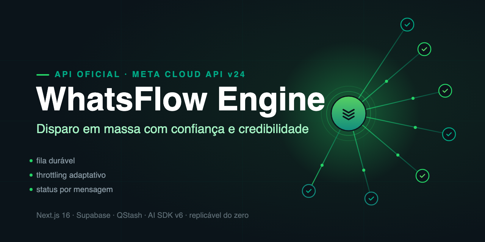
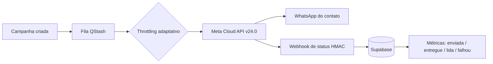

# WhatsFlow Engine



> Sistema organizacional de disparo em massa no WhatsApp com confiança e credibilidade — construído sobre o uso primário da API Oficial do WhatsApp (Meta Cloud API) e desenhado para ser replicado.

     

Criado e mantido por **Luiz Henrique** ([@luizxhgomes](https://github.com/luizxhgomes))

---

## Visão geral

O WhatsFlow Engine é um SaaS single-tenant completo de automação de marketing e atendimento no WhatsApp. Ele resolve o problema central do disparo em massa: fazer campanhas em escala **sem queimar o número, sem banimento e sem gambiarras** — porque toda a comunicação passa exclusivamente pela **API Oficial do WhatsApp (Meta Cloud API v24.0)**, nunca por bibliotecas não-oficiais de engenharia reversa.

O que o torna interessante como referência de construção de sistema é a orquestração ponta a ponta: fila durável com QStash, throttling adaptativo por qualidade de número, templates aprovados pela Meta, rastreio de status por mensagem (enviada, entregue, lida, falhou) e um workflow builder visual para jornadas conversacionais. A camada de IA (Vercel AI SDK v6, multi-provider) responde conversas no inbox com memória persistente.

A qualidade é garantida por mais de 3.500 testes (Vitest + Playwright), lint estrito e CI. A arquitetura segue um padrão único e auditável em todas as features: **Page → Hook → Service → API Route**.

O sistema foi desenhado para ser **replicado**: um installer automático provisiona Supabase e Vercel, e o guia de setup cobre do app da Meta ao deploy.

```bash
git clone https://github.com/luizxhgomes/whatsflow-engine.git
cd whatsflow-engine/app
cp .env.example .env   # preencha as credenciais
npm install && npm run dev
```

## Por que API Oficial (confiança e credibilidade)

| Pilar | Como o engine implementa |
|---|---|
| **Zero engenharia reversa** | 100% Meta Cloud API v24.0. Sem Baileys, sem web-scraping, sem risco de ban por protocolo. |
| **Templates aprovados** | Ciclo completo de criação, submissão e aprovação de templates HSM direto pela Meta. |
| **Qualidade de número** | Throttling adaptativo (`WHATSAPP_ADAPTIVE_*`): a taxa de envio reage ao rating de qualidade do número. |
| **Opt-in e rastreabilidade** | Contatos com origem rastreada, import CSV validado, status por mensagem via webhooks assinados (HMAC). |
| **Rate limits respeitados** | Fila durável QStash com concorrência configurável e retry com backoff. |

## Arquitetura do disparo



Padrão de código em todas as features:

```
Page (App Router) → Hook (estado/TanStack Query) → Service (regra de negócio) → API Route (integração)
```

## Estrutura do repositório

```
whatsflow-engine/
├── app/                      # o sistema (Next.js 16)
│   ├── app/                  #   34 páginas + 217 rotas de API
│   ├── components/ hooks/ services/ lib/   # camadas (ver abaixo)
│   ├── supabase/migrations/  #   schema (35+ tabelas, 7 domínios)
│   └── infra/                #   Docker, VPS, deploy
└── docs/
    ├── architecture/         # ADRs + TOPOLOGIA.md (documento único de topologia)
    ├── setup/                # replicação passo a passo
    └── prd/ epics/ stories/  # metodologia story-driven
```

Topologia completa (física, lógica, execução, dados e replicação):
**[`docs/architecture/TOPOLOGIA.md`](docs/architecture/TOPOLOGIA.md)**

## Componentes

| Componente | Quantidade |
|---|---|
| Rotas de API | 217 |
| Páginas (App Router) | 34 |
| Componentes React | 444 |
| Hooks | 61 |
| Migrations Supabase | 10 |
| Arquivos de teste | 114 (3.500+ testes) |

Funcionalidades: inbox de atendimento com visual WhatsApp Business, campanhas em massa com métricas, contatos + import CSV, templates HSM com preview fiel, workflow builder visual (React Flow), installer automático (Supabase + Vercel), diagnóstico da integração Meta, push notifications, IA multi-provider com memória.

## Stack

Next.js 16 (App Router, Turbopack) · React 19 · TypeScript 5.7 · Supabase (Postgres + Auth + Storage) · Upstash QStash + Redis · Meta WhatsApp Cloud API v24.0 · Vercel AI SDK v6 (Anthropic, OpenAI, Google) · Tailwind 4 + Radix/shadcn · Vitest + Playwright.

## Replique em 30 minutos

1. **Supabase** — crie um projeto e rode as migrations de `app/supabase/migrations/`.
2. **Meta** — crie um app WhatsApp Business, conecte o WABA, gere token permanente e configure o webhook (guia em [`docs/setup/`](docs/setup/README.md)).
3. **Upstash** — crie o QStash e o Redis, copie tokens.
4. **Variáveis** — `cp app/.env.example app/.env` e preencha.
5. **Deploy** — Vercel (recomendado) ou Docker/VPS (`app/infra/`). O installer embutido (`/api/installer`) automatiza o provisionamento.

Guias completos: [`docs/setup/README.md`](docs/setup/README.md) · [`docs/guides/`](docs/guides/) · [`app/infra/DEPLOY-GUIDE.md`](app/infra/DEPLOY-GUIDE.md)

## Metodologia

Desenvolvimento story-driven: PRD → epics → stories com acceptance criteria → implementação → QA gate. Os artefatos reais estão versionados em [`docs/prd/`](docs/prd/), [`docs/epics/`](docs/epics/) e [`docs/stories/`](docs/stories/) como registro do método.

## Regras inegociáveis

1. Somente API Oficial da Meta — nenhuma dependência de protocolo não-oficial.
2. Nenhum segredo no repositório — tudo via variáveis de ambiente (`.env.example` documenta o contrato).
3. Disparo responsável — throttling, opt-in e templates aprovados não são opcionais.
4. Todo código novo entra com teste.

## Contribuindo

Veja [CONTRIBUTING.md](CONTRIBUTING.md). Issues e PRs são bem-vindos.

## Licença

[MIT](LICENSE). WhatsApp e Meta são marcas de seus respectivos donos; este projeto não representa afiliação oficial com a Meta.

## Autor

**Luiz Henrique** — engenharia de sistemas de IA e automação · [@luizxhgomes](https://github.com/luizxhgomes)
