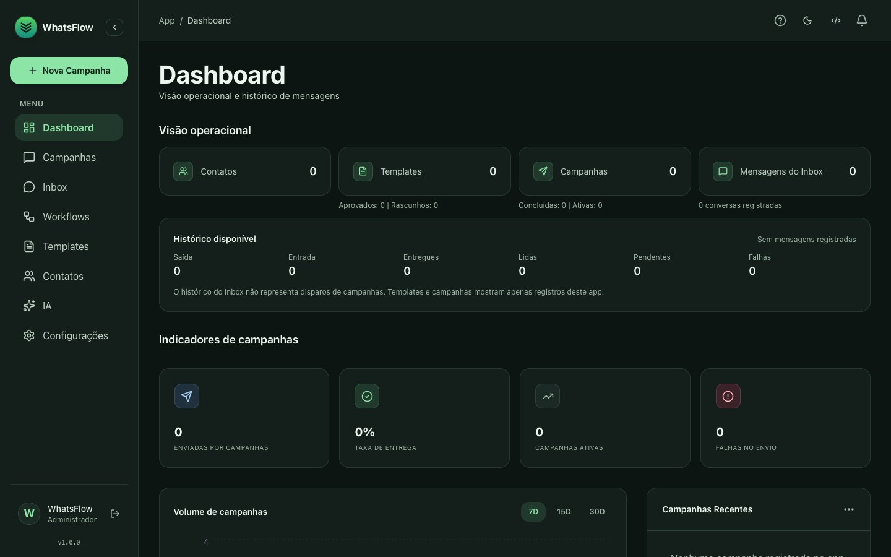
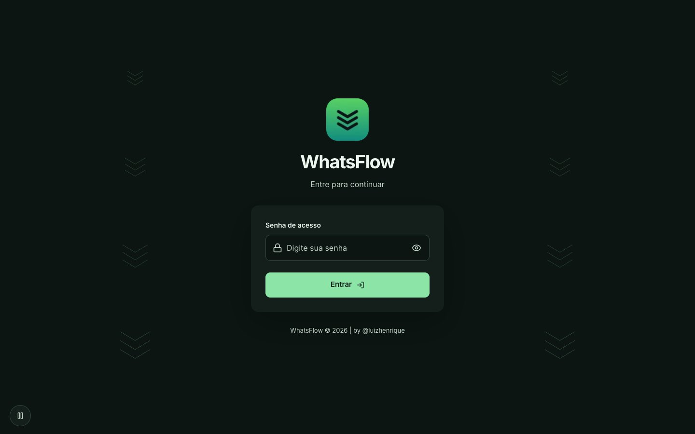
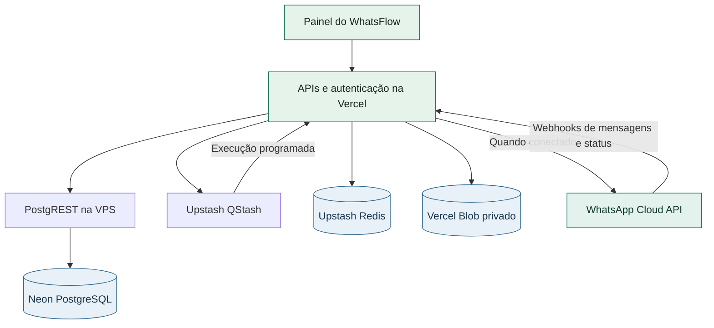

<p align="center">
  
</p>

<h1 align="center">WhatsFlow Engine</h1>

<p align="center">Organize contatos, campanhas e atendimento pelo WhatsApp em um só painel.</p>

<p align="center">
  <a href="https://whatsflow-engine.vercel.app/">Abrir WhatsFlow</a> |
  <a href="#primeiro-acesso">Primeiro acesso</a> |
  <a href="#arquitetura-publicada">Arquitetura</a> |
  <a href="CHANGELOG.md">Histórico de entregas</a>
</p>



*Dashboard em ambiente de demonstração, com a interface da revisão publicada.*

<details>
<summary>Ver a tela de entrada</summary>



</details>

## Primeiro acesso

1. Abra o painel e entre com a senha administrativa. [WhatsFlow em produção](https://whatsflow-engine.vercel.app/)
2. Quando a Meta estiver sem configuração, escolha **Configurar do zero** ou **Explorar o painel**.
3. Em **Explorar o painel**, você pode cadastrar contatos e conhecer as áreas. O assistente fica fechado durante a sessão, inclusive depois de recarregar, e volta no próximo login enquanto a Meta estiver sem configuração.
4. Quando quiser habilitar envio e recebimento, retome em **Configurações** ou em **Tutoriais de Configuração**. [Guia de configuração](docs/setup/README.md)

## O que você encontra no painel

| Área | O que você pode fazer |
|---|---|
| **Dashboard** | Acompanhar totais de contatos, templates, campanhas e histórico do Inbox em indicadores separados. |
| **Contatos** | Cadastrar ou importar por CSV, usar tags e campos personalizados e gerenciar opt-in. |
| **Templates** | Preparar rascunhos, visualizar a mensagem e sincronizar modelos aprovados com a Meta conectada. |
| **Campanhas** | Montar o público e a mensagem, programar o envio e acompanhar os estados do disparo. |
| **Inbox** | Organizar conversas, acompanhar a entrega de mensagens e responder pelo canal conectado. |
| **Workflows e IA** | Desenhar fluxos e configurar agentes de atendimento com os provedores da sua operação. |

Envio e recebimento pelo WhatsApp dependem da conexão com a Meta. Os estados de entrega são atualizados pelos eventos recebidos no webhook. [Integração com a API oficial](docs/seguranca/CONTRATO-API-OFICIAL.md)

## Arquitetura publicada

A interface Next.js e as APIs rodam na Vercel. Os registros ficam no Neon PostgreSQL, acessado pelo PostgREST na VPS com permissão limitada. O Upstash oferece filas e cache, e o Vercel Blob guarda mídias em armazenamento privado.



A organização do código segue páginas, hooks, serviços, APIs e adaptadores de integração. [Topologia e domínios do sistema](docs/architecture/TOPOLOGIA.md)

## Evolução verificada

| Entrega | Resultado |
|---|---|
| **Infraestrutura própria** | Banco Neon, filas e cache Upstash e mídia privada, com configuração por ambiente. |
| **Operação do zero** | Base operacional reiniciada após backup, com cadastro e importação disponíveis no painel. |
| **Onboarding opcional** | Dois logins em produção confirmaram que é possível explorar o painel e receber o convite de configuração novamente no próximo acesso. |
| **Identidade visual** | Logo oficial no login, animação com pausa, temas claro e escuro e espaçamentos que acompanham a largura da tela. |
| **Publicação protegida** | O build verifica o CSS referenciado pelo login e pelo dashboard. A revisão corrigida foi conferida em produção, de 320 a 2.880 px, com as rotas principais nas duas larguras extremas. |

**Revisão publicada em 10/11/2026** | [`ec7fab5`](https://github.com/luizxhgomes/whatsflow-engine/commit/ec7fab59d21aa624594d01f1c19a5dea3069213b) | [Changelog](CHANGELOG.md)

## Desenvolvimento local

Use Node.js 22 e selecione a revisão que deseja executar no GitHub. Instale as dependências a partir de `app/`.

```bash
git clone https://github.com/luizxhgomes/whatsflow-engine.git
cd whatsflow-engine/app
npm ci
cp .env.example .env.local
```

Preencha as variáveis do seu ambiente em `.env.local` e execute `npm run dev`. Para gerar e verificar o pacote de produção, use `npm run build`. [Ambientes e configuração](docs/setup/README.md)

| Referência | Conteúdo |
|---|---|
| [Documentação](docs/README.md) | Navegação pelos guias, arquitetura e segurança. |
| [Checklist de publicação](docs/guides/deploy-checklist.md) | Build, CSS entregue, login e conferência visual no domínio. |
| [Lições do projeto](lessons.md) | Regras registradas a partir dos incidentes e da validação. |
| [Contribuição](CONTRIBUTING.md) | Orientações para colaborar no código. |

Mantido por **Luiz Henrique**. [GitHub do autor](https://github.com/luizxhgomes) | [Licença MIT](LICENSE)
