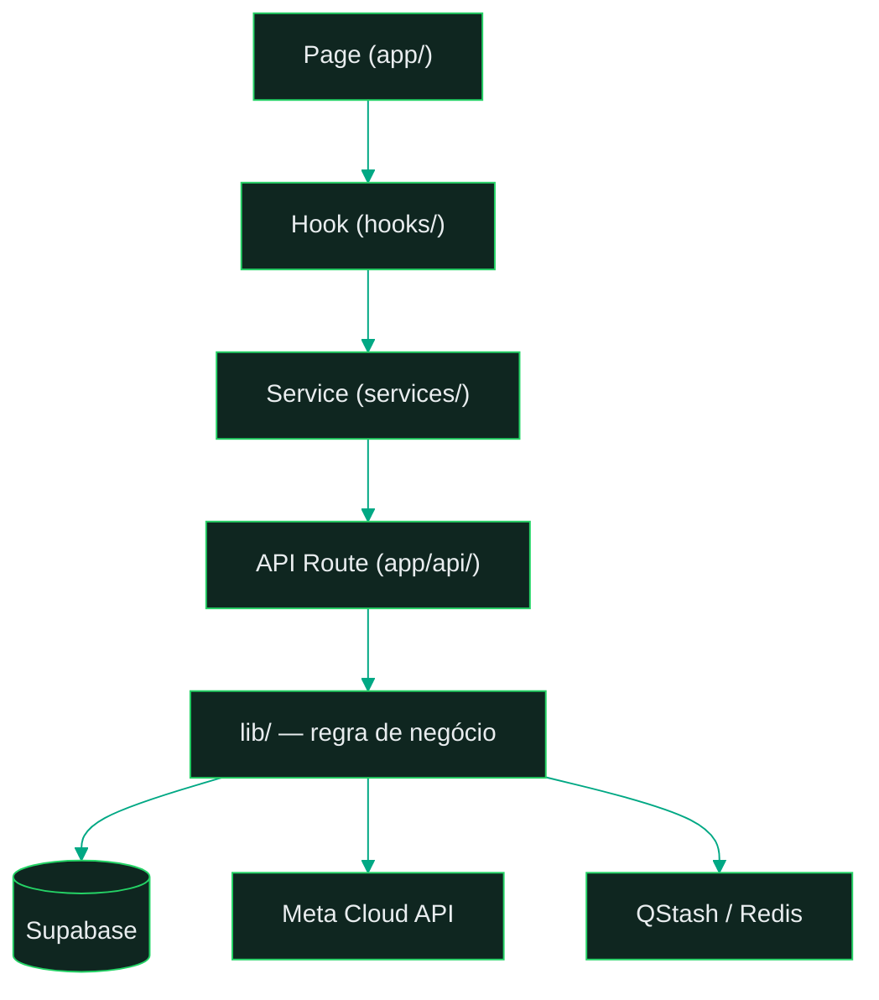
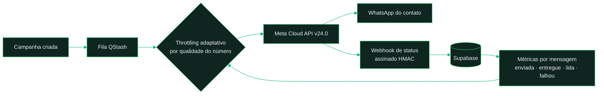
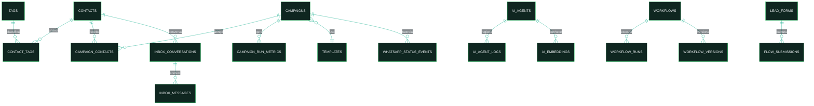

# Topologia do Sistema

Documento único de referência da estruturação organizacional do WhatsFlow Engine:
topologia física (repositório), lógica (camadas), de execução (disparo) e de dados (schema).

---

## 1. Topologia física — o repositório

```
whatsflow-engine/
├── README.md                 # visão geral, lema e quickstart
├── LICENSE · SECURITY.md · CONTRIBUTING.md · CODE_OF_CONDUCT.md · CHANGELOG.md · AUTHORS
│
├── app/                      # ★ o sistema (Next.js 16, App Router)
│   ├── app/                  #   páginas (34) + rotas de API (217) — camada de entrada
│   │   └── api/              #   webhook Meta, campanhas, installer, diagnostics, health
│   ├── components/           #   apresentação (444 componentes React)
│   ├── hooks/                #   estado e orquestração de dados (TanStack Query)
│   ├── services/             #   API client — ponte tipada entre hooks e rotas
│   ├── lib/                  #   regra de negócio e integrações
│   │   ├── whatsapp/         #     Meta Cloud API v24.0: envio, templates, mídia, throttling
│   │   ├── ai/               #     AI SDK v6 multi-provider + memória
│   │   ├── builder/          #     motor do workflow builder
│   │   ├── business/         #     regras de campanha, contato, settings
│   │   └── installer/        #     provisionamento automático Supabase + Vercel
│   ├── supabase/migrations/  #   topologia de dados (10 migrations, 35+ tabelas)
│   ├── infra/                #   Dockerfile, DEPLOY-GUIDE, setup-vps.sh
│   ├── types/ · utils/       #   contratos e utilitários compartilhados
│   ├── proxy.ts              #   middleware: auth por rota + CORS
│   └── *.test.ts(x)          #   125 arquivos de teste colocados junto do código
│
└── docs/
    ├── architecture/         # ADRs 001–004 + este documento
    ├── setup/                # replicação: Meta WABA, Supabase, Upstash, deploy
    ├── prd/ · epics/ · stories/  # metodologia story-driven (registro do método)
    └── guides/               # deploy checklist, migrations, testes de flows
```

Regra de organização: **cada camada tem uma pasta, cada pasta tem um papel único.**
Nenhum arquivo de feature vive na raiz; testes vivem ao lado do código que testam.

## 2. Topologia lógica — as camadas

Toda feature atravessa as mesmas quatro camadas, sem atalhos:



| Camada | Pasta | Responsabilidade | Não pode |
|---|---|---|---|
| Page | `app/app/` | composição de UI, rota | conter regra de negócio |
| Hook | `app/hooks/` | estado, cache, orquestração | chamar `fetch` direto |
| Service | `app/services/` | client HTTP tipado | conhecer UI |
| API Route | `app/app/api/` | validação, auth, integração | ser chamada por outra rota |
| Lib | `app/lib/` | regra de negócio pura + adapters | importar de camadas acima |

Decisões que sustentam o desenho: [ADR-001 fontes de verdade](ADR-001-fontes-de-verdade.md) ·
[ADR-002 error handling](ADR-002-error-handling.md) · [ADR-003 auth em camadas](ADR-003-auth-layering.md) ·
[ADR-004 dedup de webhook](ADR-004-webhook-dedup.md).

## 3. Topologia de execução — o disparo em massa



O laço `métricas → throttling` é o mecanismo de credibilidade: a taxa de envio
reage ao rating de qualidade do número reportado pela Meta (`WHATSAPP_ADAPTIVE_*`).

## 4. Topologia de dados — domínios do schema

35+ tabelas em 10 migrations, organizadas em 7 domínios:



| Domínio | Tabelas principais |
|---|---|
| Contatos | `contacts`, `tags`, `contact_tags`, `custom_field_definitions`, `phone_suppressions` |
| Campanhas | `campaigns`, `campaign_contacts`, `campaign_run_metrics`, `campaign_batch_metrics`, `campaign_folders`, `campaign_trace_events` |
| Mensageria/status | `whatsapp_status_events`, `webhook_events` (dedup), `push_subscriptions` |
| Inbox | `inbox_conversations`, `inbox_messages`, `inbox_labels`, `inbox_quick_replies`, `attendant_tokens` |
| IA | `ai_agents`, `ai_agent_logs`, `ai_embeddings`, `ai_knowledge_files` |
| Workflows | `workflows`, `workflow_versions`, `workflow_runs`, `workflow_builder_executions`, `workflow_conversations` |
| Templates/captação | `templates`, `template_projects`, `lead_forms`, `flows`, `flow_submissions`, `settings` |

`phone_suppressions` (opt-out) e `webhook_events` (dedup por assinatura) são as tabelas
que materializam o disparo responsável descrito no README.

## 5. Topologia visual — design system condicional (paleta WhatsApp)

A identidade usa **apenas as cores** da marca WhatsApp — nunca a logo. Fonte da
verdade: `app/lib/design-system/tokens/colors.ts` (escala `whatsapp`) e as
variáveis condicionais de tema em `app/app/globals.css`.

| Token | Hex | Papel |
|---|---|---|
| `whatsapp.400` | `#25D366` | Brand primary (dark mode primary, rings, mapa de disparos) |
| `whatsapp.500` | `#00A884` | Accent moderno (hover, focus, unread) |
| `whatsapp.600` | `#128C7E` | Teal clássico (light mode primary — AA sobre branco) |
| `whatsapp.800` | `#075E54` | Teal escuro (subtle, texto sobre accent light) |
| `whatsapp.100` | `#D9FDD3` | Balão enviado / accent light |
| `whatsapp.950` | `#0B141A` | Fundo dark do chat e das artes |

Condicionais de tema: light usa `--primary:#128C7E` (contraste AA com texto branco);
dark usa `--primary:#25D366` com foreground `#0B141A`. Os balões (`--accent`)
alternam `#D9FDD3`/`#005C4B`. A arte oficial do repo (`docs/assets/social-preview.svg`)
segue esta paleta com a estrutura de **mapa de disparos** (hub → nós com check de entrega).

## 6. Topologia de replicação

O sistema é single-tenant por desenho: **uma instância = um número = um negócio.**
Replicar é provisionar a topologia inteira de novo (Supabase + Meta + Upstash + Vercel),
sem multi-tenancy compartilhando dados. Passo a passo em [`docs/setup/`](../setup/README.md);
o installer (`/api/installer`) automatiza Supabase e Vercel.
