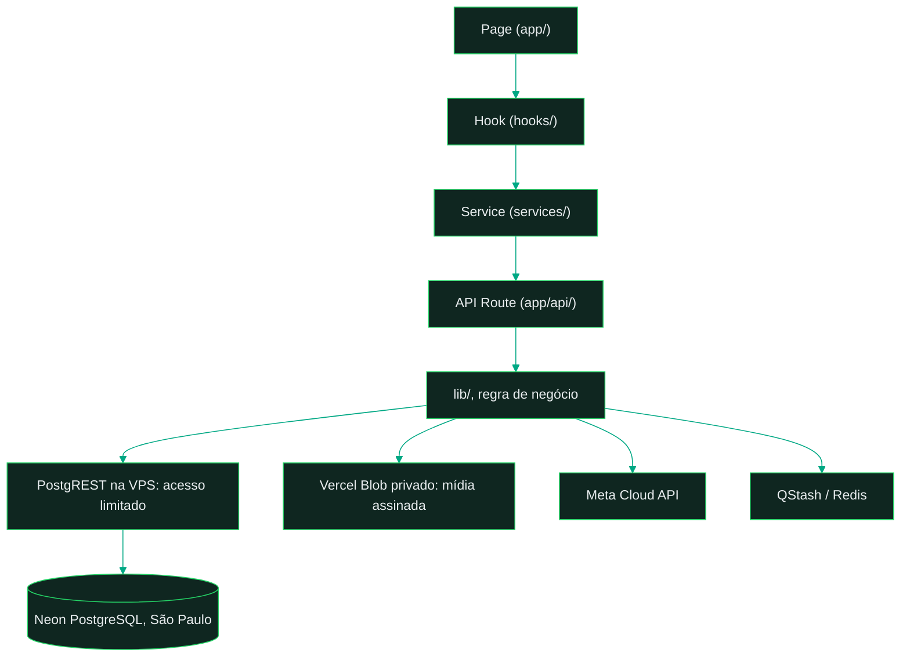
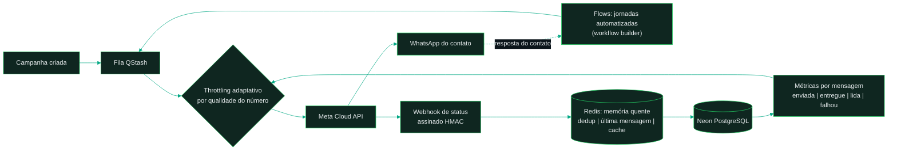
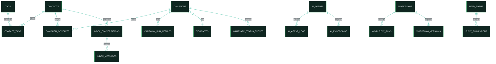

# Topologia do sistema

Documento único de referência da estruturação organizacional do WhatsFlow Engine:
topologia física (repositório), lógica (camadas), de execução (disparo) e de dados (schema).

Na revisão `ec7fab5`, publicada em 10/11/2026, o app roda na Vercel
com Next.js 16 e Node.js 22. O banco é Neon PostgreSQL em São Paulo, acessado
pelo servidor através de PostgREST na VPS com role limitada. Upstash QStash e
Redis atendem filas e cache. O Vercel Blob privado armazena mídia. A conexão com
a API oficial da Meta é opcional para explorar o painel e necessária para enviar
e receber mensagens pelo WhatsApp.

Os nomes `supabase.ts` e `supabase/migrations/` permanecem por compatibilidade
com a base original.

---

## 1. Topologia física, o repositório

```
whatsflow-engine/
├── README.md                 # visão geral, lema e quickstart
├── LICENSE | SECURITY.md | CONTRIBUTING.md | CODE_OF_CONDUCT.md | CHANGELOG.md | AUTHORS
│
├── app/                      # ★ o sistema (Next.js 16, App Router)
│   ├── app/                  #   páginas + rotas de API, camada de entrada
│   │   └── api/              #   webhook Meta, campanhas, installer, diagnostics, health
│   ├── components/           #   apresentação em componentes React
│   ├── hooks/                #   estado e orquestração de dados (TanStack Query)
│   ├── services/             #   API client, ponte tipada entre hooks e rotas
│   ├── lib/                  #   regra de negócio e integrações
│   │   ├── whatsapp/         #     Meta Cloud API: envio, templates, mídia, throttling
│   │   ├── ai/               #     AI SDK v6 multi-provider + memória
│   │   ├── builder/          #     motor do workflow builder
│   │   ├── business/         #     regras de campanha, contato, settings
│   │   └── installer/        #     installer legado Supabase + Vercel
│   ├── supabase/migrations/  #   histórico SQL, adaptado para Neon pelo runner
│   ├── infra/                #   migrate-neon.mjs, postgrest/, Docker/VPS legado
│   ├── types/ | utils/       #   contratos e utilitários compartilhados
│   ├── proxy.ts              #   middleware: auth por rota + CORS
│   └── *.test.ts(x)          #   testes colocados junto do código
│
└── docs/
    ├── architecture/         # ADRs 001-004 + este documento
    ├── setup/                # primeiro acesso e provisionamento de outra instância
    ├── prd/ | epics/ | stories/  # metodologia story-driven (registro do método)
    └── guides/               # deploy checklist, migrations, testes de flows
```

Regra de organização: **cada camada tem uma pasta, cada pasta tem um papel único.**
Nenhum arquivo de feature vive na raiz; testes vivem ao lado do código que testam.

## 2. Topologia lógica, as camadas

O fluxo principal de leitura e interação do cliente segue as camadas abaixo.
Server Components e Server Actions também usam loaders e adapters autenticados
no servidor, sem expor o acesso administrativo ao navegador:



| Camada | Pasta | Responsabilidade | Não pode |
|---|---|---|---|
| Page | `app/app/` | composição de UI, rota | conter regra de negócio |
| Hook | `app/hooks/` | estado, cache, orquestração | chamar `fetch` direto |
| Service | `app/services/` | client HTTP tipado | conhecer UI |
| API Route | `app/app/api/` | validação, auth, integração | confiar em chamada interna sem autenticação |
| Lib | `app/lib/` | regra de negócio pura + adapters | importar de camadas acima |

Decisões que sustentam o desenho: [ADR-001 fontes de verdade](ADR-001-fontes-de-verdade.md) ·
[ADR-002 error handling](ADR-002-error-handling.md) | [ADR-003 auth em camadas](ADR-003-auth-layering.md) ·
[ADR-004 dedup de webhook](ADR-004-webhook-dedup.md).

## 3. Topologia de execução, o disparo em massa



O laço `métricas → throttling` é o mecanismo de credibilidade: a taxa de envio
reage ao rating de qualidade do número reportado pela Meta (`WHATSAPP_ADAPTIVE_*`).

Camadas de estado da execução: o Redis é a memória quente (dedup de eventos de webhook
com TTL, última mensagem por conversa em `ai:lastmsg:*` para o debounce da IA, cache de
settings); o Neon PostgreSQL é a fonte da verdade durável. Os Flows constroem jornadas
automatizadas que reagem ao inbound do contato e reentram na fila, com estado em
`workflow_conversations`.

## 4. Topologia de dados, domínios do schema

O histórico SQL permanece em `app/supabase/migrations/`. O runner
[`migrate-neon.mjs`](../../app/infra/migrate-neon.mjs) adapta as publicações
legadas de Supabase Realtime e registra as migrations aplicadas. Na operação
Neon, o frontend usa polling autenticado. Os domínios principais são:



| Domínio | Tabelas principais |
|---|---|
| Contatos | `contacts`, `tags`, `contact_tags`, `custom_field_definitions`, `phone_suppressions` |
| Campanhas | `campaigns`, `campaign_contacts`, `campaign_run_metrics`, `campaign_batch_metrics`, `campaign_folders`, `campaign_trace_events` |
| Mensageria/status | `whatsapp_status_events`, `webhook_events` (dedup), `push_subscriptions` |
| Inbox | `inbox_conversations`, `inbox_messages`, `inbox_labels`, `inbox_quick_replies`, `attendant_tokens` |
| IA | `ai_agents`, `ai_agent_logs`, `ai_embeddings`, `ai_knowledge_files` |
| Workflows | `workflows`, `workflow_versions`, `workflow_runs`, `workflow_builder_executions`, `workflow_conversations` |
| Templates/captação | `templates`, `template_projects`, `lead_forms`, `flows`, `flow_submissions`, `settings` |

`phone_suppressions` (opt-out) e `webhook_events` (dedup por assinatura) são as tabelas
que materializam o disparo responsável descrito no README.

## 5. Topologia visual

A interface usa a logo oficial do WhatsFlow em `app/public/icons/icon-512.png`.
A fonte dos tokens consumidos pelo app é
[`app/app/globals.css`](../../app/app/globals.css). Escalas legadas em
`app/lib/design-system/tokens/` continuam como referência para componentes
anteriores.

| Token | Cor | Papel |
|---|---|---|
| `--ds-brand-primary` | `#156f58` | Verde principal |
| `--ds-brand-luminous` | `#8ce4a6` | Mint e realces no tema escuro |
| `--ds-brand-ink` | `#101e1a` | Tom escuro da marca |
| `--ds-brand-warm` | `#d06965` | Reflexo coral discreto em ícones e brilho |

Os temas controlam superfícies, texto e estados. Espaçamentos fluidos usam
`--ds-page-gutter`, `--ds-section-space` e `--ds-card-padding`. Os ícones
compartilham `.ds-icon-tile`. O login carrega Three.js sob demanda e mantém
composição estática quando há preferência por movimento reduzido ou falha de
WebGL. A validação visual inclui o CSS entregue pelo domínio público.
[Checklist de deploy](../guides/deploy-checklist.md)

## 6. Topologia de replicação

A instância publicada mantém seus dados e integrações isolados. Criar outra
instância exige provisionamento próprio de Vercel, Neon, gateway PostgREST,
Upstash e Blob. A conexão Meta pode ser feita depois.

O [guia de setup](../setup/README.md) separa primeiro acesso de provisionamento.
O installer legado (`/api/installer`) e os guias Supabase/Docker permanecem como
referência da arquitetura original.
A fachada [`lib/neon-data-api.ts`](../../app/lib/neon-data-api.ts) prioriza a URL
do gateway PostgREST configurado no servidor e conserva o endpoint Data API
legado como fallback de compatibilidade. O servidor assina o JWT e o endpoint
JWKS publica a chave pública. A mídia permanece privada no
Blob e é servida por URLs assinadas com expiração.
